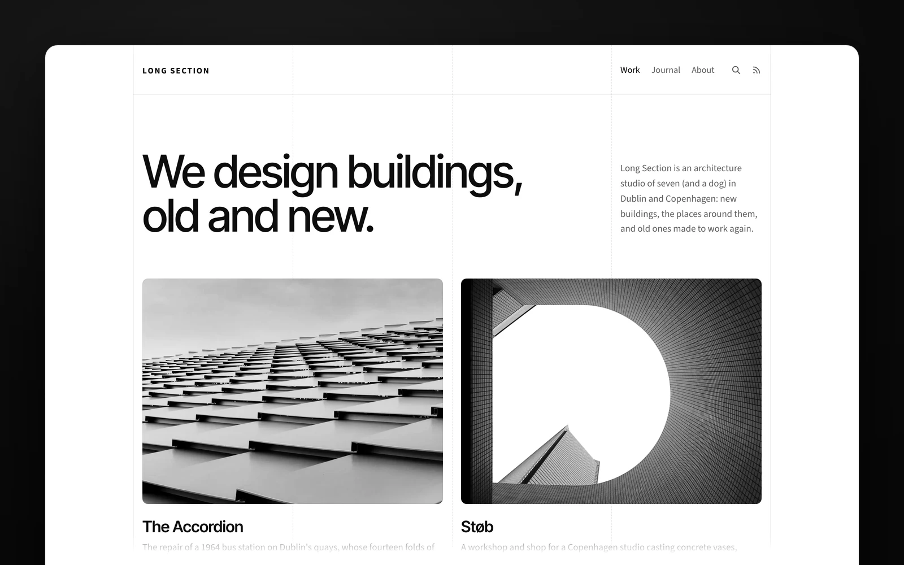

# Nohead portfolio starter



A portfolio with a journal, built with [Astro](https://astro.build) for content kept in [Nohead](https://nohead.io): a studio's projects, each with a photo gallery, a case study and a client's quote, and a journal of posts with authors, categories, search and an RSS feed. Copy it, connect it to your own Nohead project, and replace the story with your own.

The demo is Long Section, an invented architecture studio, with its people, clients, projects and journal.

## What it shows

- **Projects** with a gallery (a field holding a list of images, each with alt text) and a client's quote.
- **Posts** with one or two authors, a category, tags and a cover; **people** with their own pages; **pages** like About and the Colophon.
- **Images** in every size and crop the design needs, from one uploaded original.
- **Search** across the journal, opened with ⌘K, Ctrl+K or `/`.
- **An RSS feed**, a sitemap, link previews (Open Graph), and pages prerendered at build time and prefetched as you point at a link.

At this step the site reads its content from [`seed/`](seed), as Astro content collections ([`src/content.config.ts`](src/content.config.ts)).

## Step by step

This repository's history builds the site one step at a time. It starts with a plain Astro site reading its content from [`seed/`](seed) (Markdown, YAML and the images) as content collections, and each commit after it moves one thing onto Nohead:

1. A portfolio reading seed files as content collections
2. The content model as code
3. A seed script for the demo content
4. Swapping in Nohead's Astro loader, with no page changing
5. Images from Nohead's image CDN
6. Search with Nohead's public search
7. Deploying to Cloudflare or Vercel
8. Rebuilding when content is published

Every step builds the same site; `git log --reverse` lists them.

## Development

It needs Node 22.23.4 or newer and [pnpm](https://pnpm.io).

```bash
pnpm install
pnpm dev        # http://localhost:4322
pnpm build      # the static site, in dist/
pnpm check      # types, in .astro files too
pnpm format     # Prettier, .astro files included
```

The same checks and a build run on every push and pull request ([`.github/workflows/ci.yml`](.github/workflows/ci.yml)).

Set `SITE_URL` to the deployed address when you build for production (`SITE_URL=https://example.com pnpm build`): the feed, canonical links and link-preview images are absolute URLs built from it. Without it the build warns and uses `http://localhost:4322`.

## Credits

The typefaces are [Inter Tight](https://fonts.google.com/specimen/Inter+Tight) and [Source Sans 3](https://fonts.google.com/specimen/Source+Sans+3), under the SIL Open Font License. The photographs come from [Unsplash](https://unsplash.com) and the people's portraits from [UI Faces](https://uifaces.co); [`seed/images/README.md`](seed/images/README.md) credits each one.

## License

[MIT](LICENSE). The photographs and portraits keep their own licenses, listed in the credits.
